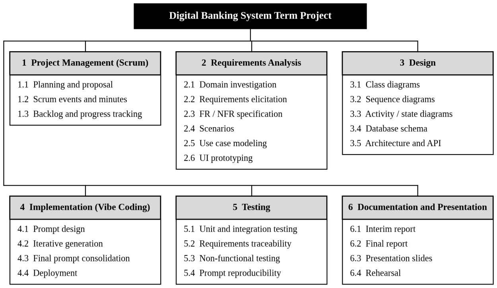
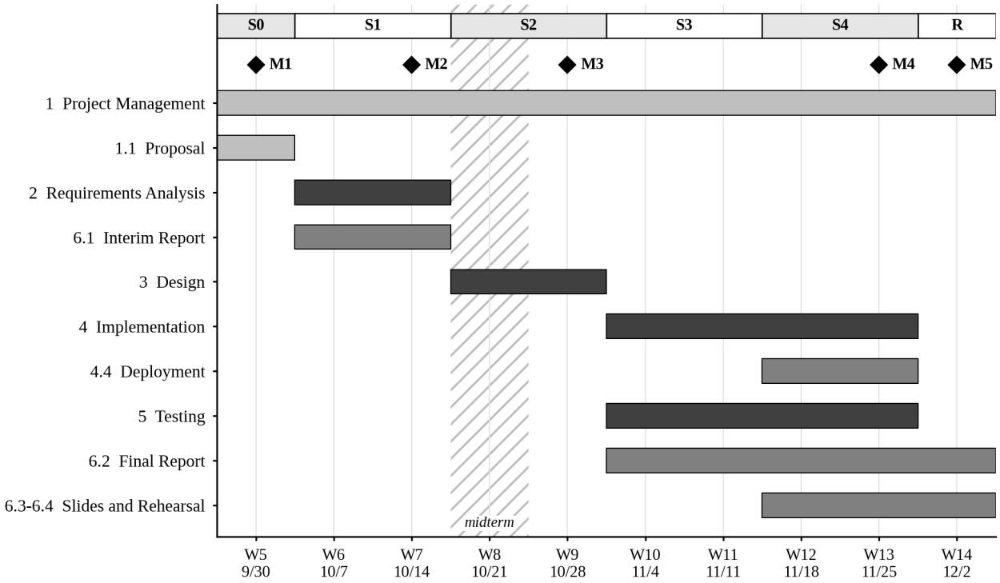

**SOFTWARE ENGINEERING TERM PROJECT** 
Revised Proposal for the Interim Report

# A Digital Banking System for Shared Group Money

**Team: Finger Burning Dragon** 
Flora · 26170192 
Jon · 26512006 
Junseop · 22101994

Course 146063-31001, Instructor: Prof. Woo-Je Kim 
Seoul National University of Science and Technology 
October 14, 2026

Project repository: https://github.com/jon-tj/banking-app 
Clickable prototype: [`/demo`](../../demo)

> This document revises the proposal submitted on September 30, 2026 ([`docs/proposal`](../proposal/FBD_Proposal.md)). The product focus has changed from fine-grained delegated access to **shared money for groups**: couples, clubs and churches. The changes are listed in the next section.

---

## Changes from the Submitted Proposal

| Area | Submitted proposal | This revision | Reason |
|------|--------------------|---------------|--------|
| Product focus | Delegated access to one owner's account | Shared money for groups (couples, clubs, churches) | The group scenarios are the real need; delegation alone did not cover saving together or contributions |
| Sharing model | Four permission scopes (a)–(d) per account and user | Groups with three roles: owner, payer, contributor | Fewer rules to specify, test and regenerate from prompts (G4) |
| Shared accounts | Ordinary accounts with delegates | One-way transfer (OWT) accounts: money enters only by transfer and leaves only as a payment | Every won in a shared account can be traced to the member who sent it |
| Automatic contributions | None | Routers: a virtual account number that splits every incoming amount by rules | Couples and members contribute from each paycheck without remembering to |
| Budgets inside a group | None | Subaccounts: a group can hold several OWT accounts, fed by a group router | A club can keep marketing, materials and joint exercises apart |
| Transparency | Not addressed | Contribution visibility per group: members or private; group details only for invited members | Clubs want to recognise their largest contributors; churches want giving to stay private |
| Setup | Manual | Account system templates: Couple, Club, Church, Custom | One step creates the right accounts, router and settings |
| Payments by others | Owner only (revised UC-06) | Owner of a personal account, or a payer of a group | The treasurer and the partner must be able to pay bills |
| Use cases | 11 | 13 | Router, groups and templates added; permission management replaced |
| Data entities | 7 | 10 | Group, Membership, Router and RouterRule added; Permission removed |

Login lockout, dispute flags, administrator investigation and data-access consent are kept unchanged, except that `blocked_until` is now an attribute of User rather than of LoginAttempt: a block belongs to the user, and the login attempts are only its log.

---

## Summary

This document describes a web-based digital banking system in which people manage money together with fictitious funds. It is built from three simple building blocks. **Personal accounts** belong to one user. **One-way transfer (OWT) accounts** belong to a group: money can only flow in, by transfer from a member, and can only leave as a payment made by a member with pay rights. **Routers** are virtual account numbers that hold no money and split every incoming amount between accounts by a list of rules. On top of these blocks, **account system templates** set up a couple's household account, a club with several budgets, or a church fund in one step, and each group chooses whether its members can see who contributed what. Only members who have accepted an invitation see anything of a group. Every transaction records who performed it. The system comprises thirteen use cases and ten persistent data entities, and it is developed with the Scrum framework from requirements and UML-based design to implementation by AI-assisted vibe coding and deployment as a public web application.

## I. Necessity of the Proposed System

Banking is the canonical transaction-processing domain. Every operation that changes a balance must be atomic, must leave the data in a consistent state, and must remain auditable afterwards. Because these requirements are strict yet well understood, a banking system is an ideal subject for experiencing the complete software development life cycle, in which a defect in requirements or design propagates visibly into the delivered system [1], [2].

Beyond its pedagogical value, the system addresses a practical need. Much of everyday money is shared: a couple's rent and groceries, a hiking club's dues, a church's building fund. Korean banks already offer group accounts, as reviewed in Section III-B, but these services treat a group account as one pot with a list of members. They do not help members put money in automatically when their income arrives, they do not let a group divide its money into budgets, and they apply the same transparency to every group, although a club that wants its members to see and thank its largest contributors and a church whose members give anonymously have opposite needs.

The proposed system meets these needs with a small number of general rules instead of special features for each kind of group. A couple, a club and a church use the same three building blocks, configured differently by a template. This keeps the logic simple enough to specify precisely, which matters for a project whose code is generated from its specifications. It requires no integration with real financial networks, which keeps the scope realistic for a single semester.

## II. Goal of the Project

The overall goal is to deliver a working, deployed web application in which users manage personal accounts, share money in groups through OWT accounts, and route income automatically, with fictitious funds, developed iteratively with the Scrum framework. This goal is refined into five verifiable objectives:

- **G1 Functional completeness.** All thirteen use cases defined in Section IV are implemented and usable through a public execution URL.
- **G2 Transactional integrity.** Every balance-changing operation is atomic, including a router deposit together with all the transfers it causes, and the sum of all balances always reconciles with the transaction ledger.
- **G3 Traceability.** Every functional requirement is traced forward to at least one use case, design element and test case, recorded in a requirements traceability matrix.
- **G4 Specification quality and reproducibility.** The requirements and design specifications, together with the final prompts, are precise enough that re-running the prompts in a clean environment reliably regenerates a working system. This is verified by at least three independent regeneration runs.
- **G5 Process discipline.** Every sprint ends with a review of a working increment, and each course milestone listed in Section VI is met on or before its date.

## III. Description of the Problem

### A. Current Situation

Consider three groups.

**A couple.** Minji and Joon share rent, utilities and groceries. Each payday, each of them must remember to transfer their share to a joint account. Amounts are agreed once but transferred by hand every month, and when one of them forgets, the rent payment fails or the other covers it.

**A club.** Seoul Trail Club collects monthly dues into an account managed by its treasurer, Hana. The money pays for promotion, equipment and shared hikes, but it sits in one pot, so the club cannot see how much is left for each purpose without a separate spreadsheet. The club would like to thank its most generous members in front of the other members, but has no record of who contributed what other than the transaction list.

**A church.** Grace Church collects offerings for its building fund. Members give at different levels and many prefer that nobody, including other members, sees how much they give. The treasurer still needs a full record for accountability.

In all three cases, if a payment appears that nobody recognises, the group has no structured way to report it inside the service, and a bank employee investigating it would typically see the members' personal details.

### B. Related Work

The KakaoBank group account is a personal account held in the name of the group owner. Members can view the dues and the transaction history, but the rights to pay out funds and to close the account belong to the owner [3]. Toss Bank introduced the concept of co-leaders in 2023. Any co-leader can withdraw and transfer funds, there is no limit on the number of co-leaders, and co-leaders receive real-time notifications of withdrawals and transfers [4].

Both services confirm that shared accounts are a real and widespread need. Both model a group as one account with members in fixed roles. Recurring transfers in conventional banking move a fixed amount on a fixed date, independent of when or how much income arrives. The proposed system differs in four respects:

- Income can be split automatically, by percentage or fixed amount, the moment it arrives.
- A group can hold several accounts as budgets, fed by one group account number.
- Money in a shared account can be traced to the member who sent it, and every payment to the member who made it.
- Each group decides who may see individual contributions.

### C. Problems Addressed

- **P1 Manual contributions.** Members must remember to transfer their share each time income arrives.
- **P2 One pot for many purposes.** A group cannot keep separate budgets without separate, unconnected accounts or spreadsheets.
- **P3 One transparency rule for all groups.** Groups cannot choose whether members can see each other's contributions or not.
- **P4 Weak accountability.** It is not always clear who put money into a shared account and who took it out.
- **P5 Complex setup.** Combining accounts, members and automatic transfers correctly is too much work for an ordinary user.
- **P6 No dispute channel.** Users cannot flag a transaction they did not initiate and follow its resolution within the system.
- **P7 Oversight versus privacy.** Investigating a transaction usually grants staff unrestricted access to the client's personal data.
- **P8 Credential attacks.** Without protective measures, repeated guessing of passwords can compromise accounts.

**Table I. Problems and Addressing Use Cases**

| ID | Problem | Addressed by |
|----|---------|--------------|
| P1 | Manual contributions | UC-05 Manage Router; UC-08 Deposit Funds |
| P2 | One pot for many purposes | UC-04 Set Up Group from Template (subaccounts); UC-05 (group router) |
| P3 | One transparency rule for all groups | UC-06 Manage Group; UC-10 View History and Contributions |
| P4 | Weak accountability | UC-07, UC-09 (actor recorded); UC-10 |
| P5 | Complex setup | UC-04 Set Up Group from Template |
| P6 | No dispute channel | UC-11 Flag Unauthorised Transaction; UC-12 Investigate Transactions |
| P7 | Oversight versus privacy | UC-12 (masked data); UC-13 Manage Data-Access Consent |
| P8 | Credential attacks | UC-02 Log In and Log Out (lockout) |

### D. Scope and Boundaries

**In scope:** user registration and authentication; personal spending and savings accounts; groups with OWT accounts and subaccounts; personal and group routers; account system templates; contribution visibility within a group; internal transfers; simulated deposits; payments and withdrawals recorded on the sender side; transaction history; dispute flags; and administrator investigation under client consent.

**Out of scope:** real money, integration with external banks or card networks, recipient-side processing of external payments, scheduled or recurring transfers (routers act only when money arrives), interest, loans, foreign currencies, native mobile applications, tax receipts for donations, and regulatory identity verification beyond what a demonstration requires.

## IV. Main Functions of the Target Information System

The functions are described below as use cases. The interim report elaborates them following the course's contents for a software requirements specification, which are based on IEEE Std 830 [5]. Those contents are the problem description, the system environment, the functional and non-functional requirement specifications, scenarios, the use case diagram, and supplementary diagrams. ISO/IEC/IEEE 29148:2018, which supersedes IEEE Std 830, serves as a supplementary reference [6].

In accordance with the course convention, the name of each use case is also the name of the corresponding functional requirement. Accordingly, UC-01 to UC-13 map one-to-one onto the functional requirements FR-01 to FR-13, which are specified with acceptance criteria in [FR_Specification.md](FR_Specification.md).

### A. Building Blocks

Every feature is built from the following three blocks. Templates (UC-04) only combine and configure them; they add no rules of their own.

**Table II. Building Blocks**

| Block | Owned by | Holds money | Money comes in | Money goes out |
|-------|----------|-------------|----------------|----------------|
| Personal account, spending | One user | Yes | Deposits; transfers from anyone; router rules | Transfers; payments by the owner |
| Personal account, savings | One user | Yes | Transfers from the owner's accounts; router rules | Transfers to the owner's accounts |
| OWT account | A group | Yes | Transfers from members' spending accounts; router rules | Payments by the group's owner or payers only |
| Router | A user or a group | No, always ₩0 | Deposits; transfers | Immediately, by its rules, to its target accounts |

A **group** is a set of members together with one or more OWT accounts, an optional group router, and a contribution visibility setting. Its members have one of three roles:

- **Owner:** manages members, subaccounts, the group router and the visibility setting, and can pay.
- **Payer:** a contributor who can also pay from the group's OWT accounts.
- **Contributor:** can send money in and see the group's balance and payments.

### B. Actors

**Table III. Actors of the System**

| Actor | Description |
|-------|-------------|
| Visitor | An unauthenticated person, who can only register a user (UC-01). A visitor sees no group or account information. |
| Client | A registered user who owns personal accounts and a personal router. |
| Group owner | A client who owns a group, for example a treasurer. |
| Member | A client who is a contributor or payer in a group owned by someone else. |
| Administrator | A bank staff member who investigates transactions and handles dispute flags. |

### C. Use Cases

**UC-01 Register User.** A visitor creates a user by providing a full name, an e-mail address and a password. The e-mail address must be unique, and the password must satisfy a minimum policy (at least eight characters, including letters and digits). Passwords are stored only as salted hashes.

**UC-02 Log In and Log Out.** A client authenticates with e-mail and password, and a session is established. Every attempt is recorded. After five consecutive failed attempts, the system alerts the user and blocks further login attempts for 24 hours by setting a `blocked_until` timestamp. On each attempt, the system compares the current time with `blocked_until`; no scheduled job is used to lift the block. Logging out ends the session, and a session expires after 30 minutes without a request, checked against the time of the last request on each new request.

**UC-03 Manage Personal Accounts.** A client opens spending and savings accounts; each receives a unique account number and starts with a zero balance. The client can view the accounts with balances, rename an account, and close an account whose balance is zero, which is not the target of any router rule, and which has no open dispute flag.

**UC-04 Set Up Group from Template.** A client creates a group by choosing a template, naming the group, and adjusting the proposed settings before confirming. The client becomes the group owner. The templates are:

- **Couple:** one OWT account (for example "Our home"); the partner is invited as a payer and joins on accepting the invitation; visibility *members*. Each partner is offered a rule in their own personal router that sends a percentage or fixed amount of every income to the shared account.
- **Club:** a group router whose number is given to members for dues, and OWT subaccounts with a proposed split (for example Marketing 20 %, Materials 30 %, Joint exercises 50 %); visibility *members*, so members see who contributed most.
- **Church:** one OWT account (for example "Building fund"); visibility *private*.
- **Custom:** one OWT account; all settings chosen by the owner.

A template only creates ordinary groups, accounts, routers and rules, which can all be changed afterwards with UC-05 and UC-06.

**UC-05 Manage Router.** A client creates a personal router, or a group owner creates a group router. A router has its own account number, an ordered list of rules, and a remainder account. Each rule sends a percentage of the received amount, or a fixed amount, to a target account. Rules in a personal router may target the owner's personal accounts and OWT accounts of groups the owner is a member of; rules in a group router may target only that group's OWT accounts. The system shows a preview of how a sample amount would be split. Changes take effect for the next incoming amount.

**UC-06 Manage Group.** The group owner invites registered users as contributors or payers. An invited user sees the group's name, their role and its contribution visibility, and becomes a member only on accepting the invitation; until then nothing is shared with them, and they can decline. The owner also changes a member's role, removes members, adds, renames or closes subaccounts (an OWT account can be closed only at a zero balance), and sets the contribution visibility to *members* or *private* (DR-07). Members can leave a group at any time. Every change is recorded.

**UC-07 Transfer Funds.** A client transfers an amount from a personal account to another account, identified by its account number, subject to the flow rules of Table II: to any spending account, to the client's own savings accounts, to an OWT account or group router of a group the client is a member of, or to the client's own router. The system verifies that the amount is positive and that both accounts are open. The debit and credit are executed as one atomic transaction, and the record stores the acting user in addition to both accounts.

**UC-08 Deposit Funds.** A client adds fictitious funds, simulating a salary or a cash deposit, to an owned spending account or to the client's router, subject to a configurable per-operation limit. When the target is a router, the deposit and every transfer caused by its rules are recorded and executed as one atomic transaction (DR-05). An amount transferred to a router (UC-07) is split in the same way.

**UC-09 Make Payment or Withdrawal.** The owner of a spending account, or the owner or a payer of a group, pays an external payee, identified by name and reference, from that account. As this is a demonstration system, payments are recorded only on the sender's side. A withdrawal is treated as a payment to the acting user. Payments from savings accounts are not possible. An OWT account cannot be paid below zero (DR-06).

**UC-10 View History and Contributions.** The owner of an account, or a member of the group that holds it, lists its transactions, filtered by period, type or counterparty. Each entry shows the user who initiated it, and router transfers show the deposit that caused them. For OWT accounts, the system also shows the contributions per member, as far as the group's visibility setting allows (DR-07). Group information is shown only to active members; there is no public view of a group.

**UC-11 Flag Unauthorised Transaction.** A client flags a transaction on an owned account, or on an OWT account of a group the client owns, as unauthorised or not initiated by the client, stating a reason. The flag progresses through the states Open, Under Review and Resolved (confirmed or rejected), and the client can follow its status.

**UC-12 Investigate Transactions.** An administrator searches transactions by time range or by user and reviews open flags, updating their status with a note. Personal details of clients are masked by default on investigation screens.

**UC-13 Manage Data-Access Consent.** To see a client's personal details, an administrator must request consent for a specific flag. The client grants or denies the request; a granted consent is time-limited (72 hours) and revocable. Expiry is determined by comparing the current time with the consent's `expires_at` timestamp whenever personal details are requested; no scheduled job is used. Every access to personal details is logged.

**Table IV. Summary of Use Cases**

| ID | Use case | Primary actor | Problem |
|----|----------|---------------|---------|
| UC-01 | Register User | Visitor | — |
| UC-02 | Log In and Log Out | Client | P8 |
| UC-03 | Manage Personal Accounts | Client | — |
| UC-04 | Set Up Group from Template | Client | P2, P5 |
| UC-05 | Manage Router | Client, Group owner | P1, P2 |
| UC-06 | Manage Group | Group owner, Member | P3 |
| UC-07 | Transfer Funds | Client, Member | P4 |
| UC-08 | Deposit Funds | Client | P1 |
| UC-09 | Make Payment or Withdrawal | Client, Group owner, Member (payer) | P4 |
| UC-10 | View History and Contributions | Client, Member | P3, P4 |
| UC-11 | Flag Unauthorised Transaction | Client, Group owner | P6 |
| UC-12 | Investigate Transactions | Administrator | P6, P7 |
| UC-13 | Manage Data-Access Consent | Client, Administrator | P7 |

### D. Scenarios

The scenarios below follow the example users of the prototype.

**S1 Couple.** Minji chooses the *Couple* template, names the account "Our home" and invites Joon as a payer; Joon sees that contributions are visible to members and accepts. Minji accepts the offered router rule "30 % of every income to Our home"; Joon sets "₩800,000 to Our home" in his own router. When Minji's salary of ₩3,400,000 arrives at her router, ₩1,020,000 goes to Our home and the rest to her spending account, in one transaction. Joon pays the rent from Our home; the history shows that Joon made the payment.

**S2 Club.** Hana chooses the *Club* template for Seoul Trail Club and keeps the proposed subaccounts Marketing (20 %), Materials (30 %) and Joint exercises (50 %). Members transfer their ₩30,000 monthly dues to the club's router number, and each payment is split across the three subaccounts. Hana pays a cabin deposit from Joint exercises. Because the club's visibility is *members*, every member sees the contributors ranked by how much they have paid in; nobody outside the club sees anything.

**S3 Church.** Choi chooses the *Church* template for the Grace Church building fund. Members transfer offerings to the fund, some of them through a rule in their own router. Because the visibility is *private*, each member sees only their own giving and the fund's total, while Choi, as owner, sees every contribution.

### E. Non-functional Requirements

Non-functional requirements are classified into product, organisational and external requirements [2]. Product requirements constrain the behaviour of the delivered system. Organisational requirements follow from the policies and procedures of the course. External requirements arise from factors outside the system and its development process.

#### Product requirements

- **NFR-01 Performance.** The account overview, including balances, loads within 3 seconds under normal load.
- **NFR-02 Reliability.** The system is available at least 99% of the time during the evaluation period (Weeks 12 to 14), and no committed transaction is lost.
- **NFR-03 Security.** Passwords are stored as salted hashes, all traffic uses HTTPS, every request is authorised on the server side, and repeated failed logins trigger the lockout of UC-02.
- **NFR-04 Usability.** Core tasks can be completed in a desktop or mobile web browser without prior training. A first-time user can set up a group from a template in under two minutes.
- **NFR-05 Maintainability.** All components are unit tested, and the main flows (UC-02, UC-04, UC-07, UC-08 with a router, and UC-11) are covered by integration tests.

#### Organisational requirements

- **NFR-06 Development process.** The system is implemented by AI-assisted vibe coding, and the final prompts must reproduce a working system.
- **NFR-07 Modeling standard.** Requirements and design models are expressed in UML and produced with StarUML.
- **NFR-08 Documentation.** All deliverables are written in English and submitted in PDF format. Reports are single-spaced in a 12-point font with 1-inch margins.

#### External requirements

- **NFR-09 Privacy.** Personal details of clients are disclosed to staff only under the consent mechanism of UC-13, and every such disclosure is logged. Individual contributions are shown only as the group's visibility setting allows. A user joins a group only by accepting an invitation that states the group's visibility.
- **NFR-10 Ethical constraint.** The system handles only fictitious funds and test data. No real financial data or real personal data is collected.

### F. Domain Requirements

The banking domain imposes rules that every function must respect:

- **DR-01** The balance of a personal account may become negative. No overdraft limit is imposed.
- **DR-02** Every transfer debits one account and credits another by the same amount within a single atomic transaction. At all times, the sum of balances equals the net total of deposits minus payments.
- **DR-03** Funds are denominated in Korean won (KRW), with 1 KRW as the smallest unit. All monetary values, including balances, transfer amounts, deposits, payments and fixed router rules, are stored as signed 64-bit integers, so no rounding errors can occur.
- **DR-04** A closed account can neither send nor receive funds, and a committed transaction is never modified or deleted. Corrections are made only through new transactions.
- **DR-05** A router never holds money. When an amount arrives, its rules are applied in order: a percentage rule takes that percentage of the received amount, rounded down to whole won; a fixed rule takes its amount; each rule takes at most what is left; and whatever remains goes to the remainder account. The incoming amount and all resulting transfers are committed together or not at all, and each resulting transfer records the actor of the incoming amount as its actor (so a split through a group router is credited to the member who paid) and the incoming transaction as its cause.
- **DR-06** Money enters an OWT account only by transfer, from a member's spending account or from a router, never by direct deposit, so every won can be traced to a member. It leaves only as a payment by the group's owner or a payer. An OWT account cannot be paid below zero, since no single person is liable for a group's debt.
- **DR-07** Only active members of a group see any information about it: its accounts, balances, transactions and contributions. Visitors, registered users who are not members, and invited users who have not accepted see nothing beyond the invitation itself. Within the group, contribution visibility is one of: *members* — every member sees every member's contributions with names, ranked by total, with equal totals ordered by earliest contribution; *private* — the owner and payers see every contribution; contributors see their own contributions with their name, the group's total, and other members' contributions only without a name, as "a member", with amount and date. Balances and payments are visible to all members in every case.

### G. Anticipated Data Model

Table V lists the ten data entities currently anticipated, exceeding the minimum of four required for the term project. The final schema will be derived from the class model during design.

**Table V. Anticipated Data Entities**

| Entity | Principal attributes | Use cases |
|--------|----------------------|-----------|
| User | user_id, name, email, password_hash, role, status, blocked_until | UC-01, UC-02 |
| Account | account_no, type (spending / savings / owt), owner_id or group_id, name, state, created_at | UC-03, UC-04, UC-06 to UC-10 |
| Group | group_id, name, template, visibility, owner_id | UC-04, UC-06, UC-10 |
| Membership | group_id, user_id, role (owner / payer / contributor), state (invited / active), invited_at, joined_at | UC-04, UC-06, UC-09, UC-10 |
| Router | router_no, owner_id or group_id, remainder_account | UC-04, UC-05, UC-08 |
| RouterRule | router_no, position, target_account, mode (percent / fixed), value | UC-04, UC-05, UC-08 |
| Transaction | tx_id, type, from_account, to_account / payee, amount (int64, KRW), actor_id, cause_tx_id, timestamp | UC-07 to UC-10, UC-12 |
| LoginAttempt | attempt_id, user_id, success, timestamp | UC-02 |
| TransactionFlag | flag_id, tx_id, reporter_id, reason, state, resolution_note | UC-11, UC-12 |
| Consent | consent_id, flag_id, client_id, admin_id, state, expires_at | UC-13 |

Balances are not stored but derived from the transaction ledger, or stored together with each transaction in the same atomic write, as decided during design (G2).

## V. Work Breakdown Structure

The work is decomposed into a deliverable-oriented work breakdown structure that follows the 100% rule, so that the lower-level elements together account for all the work of the project [7]. The six level-1 elements correspond to project management under Scrum, the development activities, and documentation, as shown in Fig. 1. The work packages form the initial product backlog. Table VI defines each work package, its deliverable, and the sprint in which it is planned; the sprints themselves are defined in Section VI.

<em>Fig. 1. Work breakdown structure of the term project.</em>

**Table VI. WBS Dictionary**

| WBS | Work package | Deliverable | Sprint |
|-----|--------------|-------------|--------|
| 1.1 | Planning and proposal | Project proposal; this revision | S0–S1 |
| 1.2 | Scrum events and minutes | Sprint plans, review notes, retrospective notes, minutes | All |
| 1.3 | Backlog and progress tracking | Product and sprint backlogs as GitHub issues | All |
| 2.1 | Domain investigation | Domain glossary and business rules (DR-01 to DR-07) | S1 |
| 2.2 | Requirements elicitation | Stakeholder interview notes and the couple, club and church scenarios | S1 |
| 2.3 | FR / NFR specification | Functional and non-functional requirements specification | S1 |
| 2.4 | Scenarios | Scenario descriptions for every use case | S1 |
| 2.5 | Use case modeling | Use case diagrams and descriptions | S1 |
| 2.6 | UI prototyping | Clickable prototype ([`/demo`](../../demo)) and key screens ([UI review](../ui-review/README.md)) | S1 |
| 3.1 | Class diagrams | Analysis and design class diagrams | S2 |
| 3.2 | Sequence diagrams | Sequence diagram for each core use case, including a router deposit | S2 |
| 3.3 | Activity / state diagrams | Activity diagram of router splitting; state diagram of TransactionFlag | S2 |
| 3.4 | Database schema | Logical schema and entity-relationship diagram | S2 |
| 3.5 | Architecture and API | Architecture description and API contracts | S2 |
| 4.1 | Prompt design | Prompt set derived from the specifications | S3 |
| 4.2 | Iterative generation | Generated code and prompt revision log | S3–S4 |
| 4.3 | Final prompt consolidation | Final prompt(s) for submission | S4 |
| 4.4 | Deployment | Deployed application and execution URL | S4 |
| 5.1 | Unit and integration testing | Test suite and test report | S3–S4 |
| 5.2 | Requirements traceability | Requirements traceability matrix | S4 |
| 5.3 | Non-functional testing | Performance, security and availability checks | S4 |
| 5.4 | Prompt reproducibility | Report of at least three regeneration runs | S4 |
| 6.1 | Interim report | Interim report (PDF) | S1 |
| 6.2 | Final report | Final report, 50 to 150 pages (PDF) | S3–R |
| 6.3 | Presentation slides | PowerPoint slides | S4–R |
| 6.4 | Rehearsal | Timed rehearsal of the 15-minute presentation | R |

## VI. Schedule of the Term Project

The project runs from Week 5 to Week 14 as a sequence of two-week sprints whose boundaries coincide with the fixed milestones of the course, as shown in Fig. 2 and listed in Table VII. Sprint 1 concentrated on requirements and, after the change of focus described above, on prototyping the group features. Sprint 2 coincides with the midterm examination in Week 8, so its planned load is deliberately lighter. Each sprint ends with a sprint review of a working increment and a retrospective.

**Table VII. Sprint Plan**

| Sprint | Weeks | Ends | Sprint goal |
|--------|-------|------|-------------|
| S0 | W5 | Sep. 30, 2026 | Proposal submitted; initial product backlog created from the WBS |
| S1 | W6–W7 | Oct. 14, 2026 | Requirements revised for group money and baselined; clickable prototype; interim report submitted |
| S2 | W8–W9 | Oct. 28, 2026 | Design models, database schema and API contracts completed |
| S3 | W10–W11 | Nov. 11, 2026 | Core use cases (UC-01 to UC-09) generated, integrated and tested |
| S4 | W12–W13 | Nov. 25, 2026 | Remaining use cases, deployment, final prompts and reproducibility runs |
| R | W14 | Dec. 2, 2026 | Release: final report, slides and presentation |

<em>Fig. 2. Schedule of the term project by sprint (Weeks 5 to 14).</em>

**Table VIII. Project Milestones**

| ID | Milestone | Week | Date | Type | Status |
|----|-----------|------|------|------|--------|
| M1 | Proposal submitted | 5 | Sep. 30, 2026 | Course | Done |
| M2 | Interim report submitted (requirements baseline) | 7 | Oct. 14, 2026 | Course | This document |
| M3 | Design baseline completed (end of S2) | 9 | Oct. 28, 2026 | Internal | Planned |
| M4 | System deployed and final prompts frozen (end of S4) | 13 | Nov. 25, 2026 | Internal | Planned |
| M5 | Final report, slides and presentation | 14 | Dec. 2, 2026 | Course | Planned |

## VII. Roles of Team Members

The team follows the Scrum framework. All three members are Developers, as listed in Table IX. The accountabilities of the Product Owner and the Scrum Master are not assigned to individuals but are held jointly by the whole team. Every member therefore takes part in requirements, design, vibe coding, testing and documentation.

**Table IX. Team Members**

| Member | Student ID | Scrum role |
|--------|------------|------------|
| Flora | 26170192 | Developer (shared Product Owner and Scrum Master accountabilities) |
| Jon | 26512006 | Developer (shared Product Owner and Scrum Master accountabilities) |
| Junseop | 22101994 | Developer (shared Product Owner and Scrum Master accountabilities) |

Shared accountability does not mean unassigned work. Table X shows how each responsibility is carried out and how individual responsibility is fixed. At every sprint planning, each work package in the sprint backlog is assigned to one named developer and recorded as a GitHub issue.

**Table X. Roles and Responsibilities under Scrum**

| Responsibility | Held by | How it is carried out |
|----------------|---------|-----------------------|
| Product backlog ownership and prioritisation (Product Owner) | All members | The backlog is refined and prioritised by consensus at each sprint planning |
| Process facilitation and removal of impediments (Scrum Master) | All members | Impediments are raised and resolved at the regular meeting every Wednesday, 15:30–17:00 |
| Development work: requirements, design, vibe coding and testing (Developers) | All members | Each work package is assigned to one named developer at sprint planning and tracked as a GitHub issue |
| Quality of each increment | All members | Every work item is reviewed by a developer other than its author before it is marked done |
| Documentation and submissions | All members | Report sections are assigned per sprint; the integrated report is reviewed by all members before submission |
| Presentation | Each member | Each member presents for approximately 5 minutes of the 15-minute presentation |

The regular meeting every Wednesday from 15:30 to 17:00 serves as the team's synchronisation event and hosts sprint planning, reviews and retrospectives at sprint boundaries. Minutes, backlogs, specifications, prompts and code are kept in a single GitHub repository, which serves as the one authoritative source for all project artefacts.

## VIII. Development Environment and Risk Management

### A. Tools and Environment

- UML modeling: StarUML, as designated in the course syllabus.
- Version control and collaboration: GitHub (repository listed on the cover page).
- Prototype hosting: GitHub Pages (static clickable prototype).
- Vibe coding assistant: Lovable.
- Documentation: Microsoft Word and PowerPoint; all submissions in PDF.

### B. Principal Risks

**Table XI. Principal Risks and Mitigation**

| ID | Risk | Likelihood | Impact | Mitigation |
|----|------|------------|--------|------------|
| R1 | Generated code differs between runs, so the final prompt is not reproducible | High | High | Derive prompts directly from the baselined specifications, version every prompt, and run regeneration tests at each iteration (WBS 5.4) |
| R2 | Templates and group features grow beyond the planned scope | Medium | High | Templates only configure the three building blocks and add no rules of their own; freeze the four templates and two visibility levels at the requirements baseline (M2) |
| R3 | Router splitting produces rounding or atomicity errors | Medium | High | Specify the splitting algorithm exactly (DR-05), store money as integers, and test sums against the ledger for every router deposit |
| R4 | Midterm examinations reduce available effort | High | Medium | Plan a lighter Sprint 2 around Week 8 and keep Week 14 free of development work |
| R5 | The prototype and the specification drift apart | Medium | Medium | Review the prototype against the use cases at every sprint review and regenerate the key-screen captures with the UI review script |
| R6 | Hosting outage during evaluation | Low | High | Use a managed hosting platform and prepare a local fallback for the presentation |
| R7 | A team member becomes temporarily unavailable | Medium | Medium | Cross-functional team in which every member is a Developer (Table X); all artefacts in the shared repository |

## References

[1] D. A. Gustafson, *Schaum's Outline of Software Engineering*. New York, NY, USA: McGraw-Hill, 2002.

[2] I. Sommerville, *Software Engineering*, 10th ed. Boston, MA, USA: Pearson, 2016.

[3] KakaoBank, "Group account (Moim Tongjang)," product page (in Korean). [Online]. Available: https://www.kakaobank.com/products/moim (accessed Sep. 30, 2026).

[4] CEO Score Daily, "Toss Bank challenges KakaoBank with a group account introducing co-leaders," Feb. 1, 2023 (in Korean). [Online]. Available: https://ceoscoredaily.com/page/view/2023020115195891703 (accessed Sep. 30, 2026).

[5] *IEEE Recommended Practice for Software Requirements Specifications*, IEEE Std 830-1998, 1998.

[6] *Systems and Software Engineering — Life Cycle Processes — Requirements Engineering*, ISO/IEC/IEEE 29148:2018, 2018.

[7] Project Management Institute, *Practice Standard for Work Breakdown Structures*, 3rd ed. Newtown Square, PA, USA: PMI, 2019.
